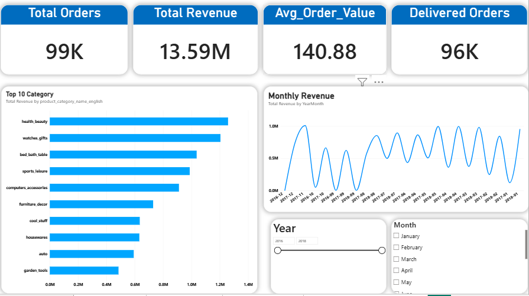
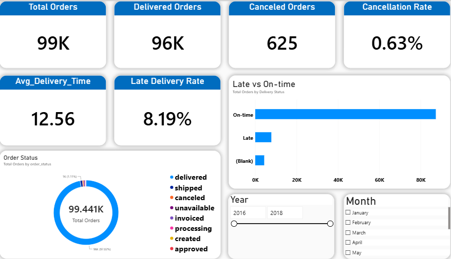
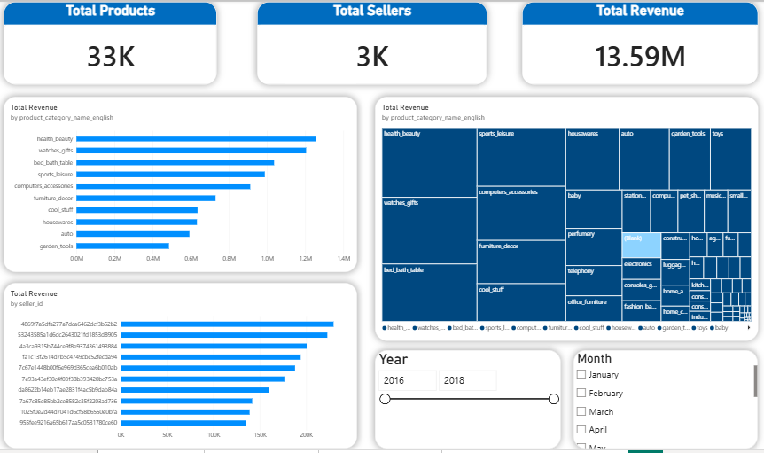
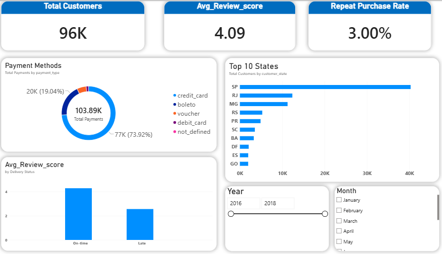

# Brazilian E-Commerce Data Analysis | Olist

## Project Overview
An end-to-end data analysis project using the Brazilian E-Commerce Public Dataset by Olist.

The project aims to analyze sales performance, customer behavior, product performance, payment methods, delivery operations, and customer satisfaction to generate actionable business insights.

## Tools & Technologies
- Microsoft SQL Server
- Power BI
- DAX
- Power Query
- Excel

## Dataset
The dataset contains Brazilian e-commerce transactions and includes:
- Customers
- Orders
- Order Items
- Products
- Order Payments
- Order Reviews
- Sellers
- Product Category Translation
- Geolocation

## Project Workflow

### 1. Data Exploration & Quality Assessment
- Explored the dataset and examined table structures.
- Checked missing values and duplicate records.
- Validated relationships between tables.
- Investigated date inconsistencies and data quality issues.
- Created SQL views for analysis while preserving the original data.

### 2. SQL Analysis
Performed business analysis using:
- Joins
- CTEs
- Window Functions
- Subqueries
- Aggregations
- CASE WHEN
- Date Functions

### 3. Power BI Dashboard
Built an interactive dashboard consisting of four pages:

#### Sales Overview
- Total Revenue
- Total Orders
- Delivered Orders
- Average Order Value
- Monthly Revenue Trend
- Top Product Categories by Revenue

#### Orders & Delivery
- Order Status Distribution
- Cancellation Rate
- Average Delivery Time
- Late Delivery Rate
- On-time vs. Late Orders

#### Products & Sellers
- Product and Seller KPIs
- Top Product Categories by Revenue
- Top Sellers by Revenue
- Revenue Distribution by Category

#### Customers, Payments & Reviews
- Total Customers
- Repeat Purchase Rate
- Average Review Score
- Customer Distribution by State
- Payment Method Distribution
- Review Score by Delivery Status

## Dashboard Preview

### 1. Sales Overview

### 2. Orders & Delivery

### 3. Products & Sellers

### 4. Customers, Payments & Reviews

## Key Business Metrics

| Metric | Result |
|---|---:|
| Total Revenue | R$13.22M |
| Total Orders | 99,441 |
| Delivered Orders | 96,478 |
| Average Order Value | R$137.04 |
| Cancellation Rate | 0.63% |
| Average Delivery Time | 12.55 Days |
| Late Delivery Rate | 8.19% |
| Unique Customers | 96,096 |
| Repeat Purchase Rate | 3.00% |
| Average Review Score | 4.09 / 5 |

## Key Insights

- Health & Beauty was the highest revenue-generating category, with approximately R$1.23M.
- Watches & Gifts ranked second, generating approximately R$1.17M.
- São Paulo (SP) had the largest customer base, with 40,302 unique customers.
- Credit cards represented 73.92% of payment records.
- Late deliveries received an average review score of 2.56, compared with 4.29 for on-time deliveries, indicating a strong association between delivery performance and customer satisfaction.

## Project Structure

- `SQL/` – SQL analysis scripts.
- `PowerBI/` – Interactive Power BI dashboard.
- `Database_Diagram/` – Database ER diagram.
- `Images/` – Dashboard screenshots.

## Conclusion
This project demonstrates an end-to-end data analysis workflow, from data exploration and quality assessment using SQL Server to business
analysis and interactive dashboard development using Power BI.

## Dataset Source

Brazilian E-Commerce Public Dataset by Olist.

[View Dataset on Kaggle](https://www.kaggle.com/datasets/olistbr/brazilian-ecommerce)

